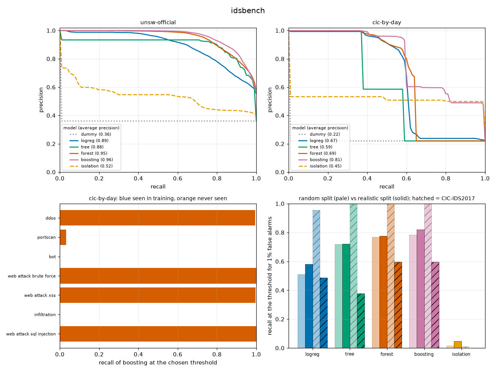

# idsbench: how well do machine-learning intrusion detectors really work?

[](https://github.com/TexAlphaWolf/ana-ml-intrusion-detection/actions/workflows/ci.yml)
[](https://github.com/TexAlphaWolf/ana-ml-intrusion-detection/actions/workflows/codeql.yml)


A benchmark of six detectors on two public datasets, **UNSW-NB15** and **CIC-IDS2017**, built to answer one question
honestly: how much of the usual "99% accuracy" survives clean data, an honest split and a threshold chosen in advance?
It is a command-line tool (`idsbench`), with tests, a Docker image, and a report generated from the measured numbers.



## What the numbers say

All figures are from one full run on the real datasets ([`docs/report.json`](docs/report.json), 711 s, seed 1000). The
alert threshold is chosen on validation rows so that 1% of normal flows alert, then applied unchanged to the test rows.

| | Random split | Realistic split |
|---|---|---|
| **CIC-IDS2017**, boosting | recall **100.0%**, average precision 1.000 | recall **59.6%**, average precision 0.807 (train Monday to Wednesday, test Thursday and Friday) |
| **UNSW-NB15**, boosting | recall 78.3% at 1.10% false alarms | recall 82.1%, but **4.35%** false alarms (the dataset's own train/test files) |

1. **A random split flatters the result.** On CIC-IDS2017 a random split gives a perfect score; splitting by day, so
   that some attacks were never seen in training, drops recall to 59.6%. boosting catches 99% of the DDoS, which
   makes up 96% of everything it catches; the port scan, 41% of the test attacks, is caught 3% of the time, and `bot` 0%.
2. **The threshold does not carry over.** Chosen for 1% false alarms on validation rows, the supervised models gave 2.72% to
   4.35% on the UNSW test file, and 0.31% to 3.94% on CIC by day.
3. **Models learn the lab, not the attack.** The most important column on UNSW is `sttl` (the time to live) and on CIC
   the destination port. Removing the TTL columns cuts logistic regression's recall from 58.0% to 30.0%; removing
   the port changes the ranking of the models (forest 0.859 on average precision, boosting 0.700).
4. **Ensembles of trees lead, and the isolation forest is weak.** Boosting and the random forest lead on average
   precision on every split but the transfer ones. The isolation forest, fitted on normal traffic only, reaches 1.6%
   recall on a random UNSW split and 0.0% on CIC by day.
5. **A model does not move between the datasets.** Trained on one and tested on the other, on the 8 features they
   share, the supervised models score about as well as always answering with the share of attacks.
6. **The datasets are full of repeats.** 102,645 of 257,673 UNSW rows (39.8%) are exact duplicates; counting them
   twice inflates every score that was published without removing them.

[`docs/analysis.md`](docs/analysis.md) goes through each experiment; [`docs/evaluation.md`](docs/evaluation.md) is the
full generated report.

## Quick start

With Docker (no network needed, read-only root, no capabilities), on synthetic data that only tests the software:

```bash
docker build -t idsbench .
docker run --rm --network none --read-only --tmpfs /tmp --cap-drop ALL -v "$PWD":/data idsbench demo --quick --out demo-out
```

With Python 3.11 or later:

```bash
pip install git+https://github.com/TexAlphaWolf/ana-ml-intrusion-detection.git
idsbench demo --quick --out demo-out       # synthetic data: says nothing about attacks, tests the pipeline
idsbench check datasets/unsw datasets/cic  # the real files, described and counted
idsbench run --unsw datasets/unsw --cic datasets/cic --out results
idsbench report results/report.json -o results/evaluation.md --figure results/summary.png   # rebuild from the JSON
```

The datasets are not in the repository; [`datasets/README.md`](datasets/README.md) says what to download and where it
goes. On Windows, `tools/run_real.ps1` builds the image, checks the files and runs the benchmark in Docker.

## What is measured

| Step | What it does |
|---|---|
| Hygiene | Removes non-finite values, rows with the same features and different labels, exact duplicates and constant columns, and counts each |
| Splits | `random` (optimistic), `official` (UNSW's own files), `by-day` (CIC, unseen attack families), `transfer` (train on one dataset, test on the other) |
| Detectors | prior-only baseline, logistic regression, decision tree, random forest, histogram gradient boosting, isolation forest (normal traffic only); same preprocessing, fixed hyper-parameters |
| Threshold | The score above which 1% of the normal validation rows alert; never tuned on the test rows |
| Reports | Average precision, ROC AUC, recall, false alarms, precision, F1 with bootstrap intervals; recall by attack family; permutation importance; where the false alarms come from |
| Ablations | `unsw-official-no-ttl` (drops `sttl`, `dttl`, `ct_state_ttl`) and `cic-by-day-no-port` (drops `destination_port`) |

## Measured results

Test rows, threshold for 1% false alarms. AP is average precision (the prior is the floor: always answering with the
share of attacks). Intervals and every other number are in [`docs/evaluation.md`](docs/evaluation.md).

| Experiment | Prior | logreg | tree | forest | boosting | isolation |
|---|---|---|---|---|---|---|
| UNSW random | 0.443 | 0.948 | 0.961 | 0.977 | 0.978 | 0.615 |
| UNSW official | 0.360 | 0.892 | 0.885 | 0.946 | 0.956 | 0.524 |
| UNSW official, no TTL | 0.360 | 0.758 | 0.839 | 0.941 | 0.949 | 0.523 |
| CIC random | 0.170 | 0.982 | 0.997 | 1.000 | 1.000 | 0.456 |
| CIC by day | 0.220 | 0.672 | 0.589 | 0.691 | 0.807 | 0.446 |
| CIC by day, no port | 0.220 | 0.616 | 0.393 | 0.859 | 0.700 | 0.438 |
| Transfer UNSW to CIC | 0.170 | 0.216 | 0.208 | 0.155 | 0.175 | 0.378 |
| Transfer CIC to UNSW | 0.443 | 0.509 | 0.455 | 0.465 | 0.481 | 0.380 |

### The data

| Dataset | Rows read | Not finite | Same features, different label | Exact duplicates | Rows kept | Features kept |
|---|---|---|---|---|---|---|
| UNSW-NB15 | 257,673 | 0 | 1,758 | 102,645 | 153,270 | 42 |
| CIC-IDS2017 | 2,830,743 | 2,867 | 6,790 | 324,542 | 2,496,544 | 69 |

Another 8,541 rows of the UNSW testing file were identical to a training row and were removed from the test.

## Where this does not apply

- The UNSW-NB15 results come from a NumPy export of the two partition files (integer codes for `proto`, `service` and
  `state`, 32-bit floats), converted to CSV, not from the official CSV files; the counts match the official ones, but
  the numbers can differ slightly on the official files, and the tables of false alarms by `service` show codes.
- The CIC-IDS2017 results use at most 500,000 training rows per experiment (a uniform subsample); the report says so.
- A single seed and split, no tuning, a 1% target, and two old lab datasets. More in
  [`docs/limitations.md`](docs/limitations.md).

## Documentation

- [`docs/analysis.md`](docs/analysis.md): what the numbers show, experiment by experiment
- [`docs/method.md`](docs/method.md): exactly what is computed and why
- [`docs/architecture.md`](docs/architecture.md): modules and data flow
- [`docs/limitations.md`](docs/limitations.md): where the numbers can mislead
- [`datasets/README.md`](datasets/README.md): the data, and where it goes
- [`CONTRIBUTING.md`](CONTRIBUTING.md), [`SECURITY.md`](SECURITY.md), [`CHANGELOG.md`](CHANGELOG.md)

## License

MIT, Luca Tessitore. The datasets belong to their authors and keep their own terms.
