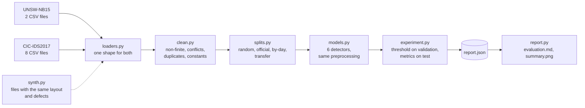

# Architecture

| Module | Does |
|---|---|
| `dataset.py` | the common shape: features, yes/no label, attack family, group (file or weekday) |
| `loaders.py` | reads the files as published; normalises column names; fixes the repeated column, the broken dash in labels, `Infinity`; drops flow identifiers |
| `clean.py` | the hygiene steps, in a fixed order, each with a count |
| `splits.py` | how rows are divided, and what each division is meant to show; the feature subset both datasets share |
| `models.py` | the six detectors as pipelines with identical preprocessing |
| `metrics.py` | average precision, ROC AUC, threshold for a false-alarm rate, operating point, precision-recall curve, bootstrap |
| `experiment.py` | runs every model on a split and collects everything as plain data; chooses the analysis model on validation rows |
| `report.py` | `evaluation.md` and the summary figure, from the JSON only |
| `synth.py` | stand-in files for tests and the demo |

`report.json` holds every number the report and the README quote, so a document can be rebuilt from it
(`idsbench report`) and the tests can check the documents against it.
